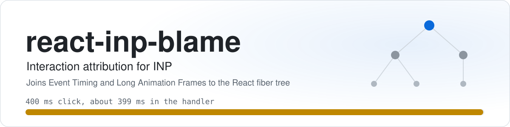

<h1 align="center">
<picture> <source media="(prefers-color-scheme: dark)" srcset="docs/media/banner-dark.svg"> 
</picture>
</h1>

<div align="center">

<a href="https://www.npmjs.com/package/react-inp-blame"></a> <a href="https://github.com/adityareddy-dev/react-inp-blame/actions/workflows/ci.yml"></a> <a href="LICENSE"></a> <a href="#versions"></a>


</div>

Click **Log in** in the demo. The report shows a 400 ms interaction, about 399 ms in the handler, and a React render that landed after the screen updated. INP didn't count that later render. Without the timeline, it is easy to investigate the render and miss the handler.

react-inp-blame joins browser interaction timing to the React tree and shows where the time went, with a component or handler name when it has one. The name can be wrong, check it against the profiler. 1.0.0 makes the API and report shape stable, with [documented exceptions](#versions). That is an API promise, not an accuracy claim. Read the [validation status and limits](#how-reliable-is-it).

**[Try the demo](https://adityareddy-dev.github.io/react-inp-blame/)**. Every scenario there is slow on purpose. Click something and read what the badge blames.

## 30-second quickstart

In an existing Next.js or Vite React app:

```sh
npm install react-inp-blame
```

Use the setup below for your framework, restart its dev server, then click a slow control and open the badge. Both setups are development-only by default. Production needs an [explicit opt-in](docs/install.md#numbers-in-development).

## Start with Next.js 14.2 or later

```ts
// next.config.ts
import type { NextConfig } from "next";
import { withInpBlame } from "react-inp-blame/next";

const nextConfig: NextConfig = { /* config options here */
};

// Your config first, this library's options second. They are not Next.js config keys.
export default withInpBlame(nextConfig, { runtime: { overlay: true } });
```

On Next.js 15.3 to 16.2, add one line to `instrumentation-client.ts` as well. `withInpBlame` prints it until the file has it (14.2 to 15.2 need nothing more):

```ts
// instrumentation-client.ts
export { onRouterTransitionStart } from "react-inp-blame/next-client";
```

## Start with Vite

```ts
// vite.config.ts
import { defineConfig } from "vite";
import react from "@vitejs/plugin-react";
import { inpBlame } from "react-inp-blame/vite";

export default defineConfig({ plugins: [react(), inpBlame({ runtime: { overlay: true } })],
});
```

React Router in framework mode, Remix, TanStack Start and Astro write their own HTML, which this plugin never sees on its own, so each has a setup of its own: [React Router](docs/install.md#install-with-react-router), [Remix](docs/install.md#install-with-remix), [TanStack Start](docs/install.md#install-with-tanstack-start), [Astro](docs/install.md#install-with-astro).

**What you will see.** Reload the page. A small dark badge sits in the corner and reads `INP —` until you interact. Click something slow and it shows the page's INP so far in milliseconds: green at 200 or under, amber up to 500, red above. Click the badge for a panel of the recent slow interactions, and click a row for the whole explanation. From the demo's sign-in page, in development, this is `report.verdict`:

    400 ms click on button "Log in" in SignInPage. The click handler handleLogin ran for
    about 399 ms; React's own render took under 1 ms. A second React render landed 295 ms
    after the screen updated: 81 ms rendering 260 components from SignInDemo down, 241 of them
    inside ProfilePage, mostly PhotoTile (240 of the 260, 72 ms). INP doesn't count it, and
    what started it can't be told.

The `overlay` option, development numbers and reading reports in code are in [Using the badge](docs/using-the-badge.md). Next.js 14.2 setup goes in `next.config.mjs`, shown there too.

## Send attribution with INP

The [web-vitals attribution build](https://github.com/GoogleChrome/web-vitals) owns the page's INP measurement. This library adds React context to it. For component names on the interaction target, `generateTarget` needs no runtime installation:

```ts
import { onINP } from "web-vitals/attribution";
import { generateTarget } from "react-inp-blame/web-vitals";

onINP((metric) => console.log(metric), { generateTarget });
```

Use web-vitals 5.1 or later. [The integration guide](docs/web-vitals.md) covers the whole-report path (`attributeINP`), production component names and the cases where no report is available. Event Timing supplies the interaction's duration and phases, and Long Animation Frames adds script and forced-layout evidence on Chromium 123 and later. For an existing OpenTelemetry web-vitals pipeline, see the [processor recipe](docs/reliability.md#opentelemetry-processor).

## How reliable is it

The current five-app cohort has no published accuracy or overhead results. Its build and interaction integrations are still pending, so selecting those apps is not evidence that attribution has been validated on them. See the [cohort status](docs/benchmarks/real-apps.md) and [measurement plan](docs/benchmarks/README.md).

The [benchmark harness](bench/README.md) now selects [five everyday apps](docs/benchmarks/real-apps.md). Their build and interaction integrations are pending, and no accuracy or overhead results exist for this cohort. The [measurement plan](docs/benchmarks/README.md) describes the protocol and selection amendment. See [validation status](#how-reliable-is-it) before treating attribution as evidence. Local copy and test steps: [reproduction](docs/reliability.md#benchmarks-and-reproduction). What 1.0 means: [What 1.0 means](docs/versions.md#what-10-means).

A report joins timing evidence with React activity. A component name is a lead to investigate, not proof that the component caused the delay. Coinciding work may be unrelated, production builds lack React render times, and browser support limits the evidence available. Check a verdict against a browser performance trace and the [known limits](docs/known-limits.md) before acting on it.

Side-by-side with Sentry, react-scan, web-vitals attribution and React 19.2 Performance tracks: [Compared with other tools](docs/comparison.md).

<a id="reporting-a-wrong-blame"></a>

## When the blame is wrong

If a report names the wrong component or handler, or a slow interaction gets no report at all, please open an issue with the [wrong or missing blame form](https://github.com/adityareddy-dev/react-inp-blame/issues/new?template=wrong-or-missing-blame.yml). What to paste, and what the form asks for: [Reporting a wrong blame](docs/reliability.md#reporting-a-wrong-blame).

## Browser support

|                                                  | Chromium | Firefox | Safari |
| ------------------------------------------------ | -------- | ------- | ------ |
| Event Timing `interactionId` (required)          | 96       | 144     | 26.2   |
| Long Animation Frames: scripts and forced layout | 123      | no      | no     |
| Performance panel tracks                         | 128      | no      | no     |

Notes on timer precision and missing APIs: [browser support notes](docs/versions.md#browser-support-notes).

## Versions

|                                              | CI runs                                                                                     | Outside that                                                                                             |
| -------------------------------------------- | ------------------------------------------------------------------------------------------- | -------------------------------------------------------------------------------------------------------- |
| react-dom                                    | 17.0.2, 18.2.0, 18.3.1, 19.0.0, 19.1.9, 19.2.8, 19.3.0, and the canary `next@canary` brings | Outside 17 to 19 that root is not read, and [one warning](docs/troubleshooting.md#react-version) says so |
| Next.js                                      | 14.2.35, 15.3.9, 15.5.26, 16.2.12, 16.3.5 and canary                                        | Below 14.2 the wrapper leaves the config as it was and [says why](docs/troubleshooting.md#next-too-old)  |
| Vite                                         | 6.4, 7.3 and 8.3; a build on Vite 5                                                         | Not tried below 5                                                                                        |
| React Router, Remix, TanStack Start          | React Router 7.18 and 8.4, Remix 2.17 on Vite, TanStack Start 1.168                         | Not tried                                                                                                |
| Astro                                        | 7.3                                                                                         | Not tried                                                                                                |
| [webpack](docs/install.md#webpack-or-rspack) | 5.111                                                                                       | Not tried                                                                                                |
| Node, for the build plugins                  | Installs and loads on 20.19, tests on 22 and 24                                             | `engines` asks for 20.19                                                                                 |

Peer dependency notes, Jest setup, the 1.x promise and the support window are in [Versions](docs/versions.md).

## What it costs

It is a development tool first, and running it in production is optional: this is what it costs where it runs. On two of the demo's scenarios, a click that re-renders 801 components and a keystroke that re-renders 1441, the library's own time was 1.3 to 3.4 ms per interaction at the median and 3.8 ms at worst at p95, in production and development builds ([how that was measured](docs/how-it-works.md#time-per-interaction)). With `enabled` at its default, neither plugin adds anything to a production build (on Next.js 15.3 to 16.2 the line's module stays, as an empty function); where it loads:

<!-- size:start -->
| Bundle (rolldown 1.2.8, minified ESM, gzip at zlib's default level) | Minified | Gzip |
| --- | --- | --- |
| `react-inp-blame/auto`: everything that loads with the page | 101.3 KB | 35.8 KB |
| The badge and panel, a chunk loaded by `import()` only when shown | 18.1 KB | 7.1 KB |
| Of `/auto`, what has to run before react-dom: the hook, the fiber reading, the observers | 32.3 KB | 11.7 KB |
| `react-inp-blame/web-vitals`, on top of `/auto` | 1.6 KB | 0.9 KB |
| `react-inp-blame/otel`, on top of `/auto` | 3.5 KB | 1.6 KB |
<!-- size:end -->

How the bundle table is kept current: [What it costs](docs/reliability.md#what-it-costs).

## Labels and personal data

Reports are made to be forwarded to error trackers and analytics, so `target.label` never reads a form field's value. The details are under [labels and personal data](docs/api.md#labels-and-personal-data) in the API page, and what the library reads, changes and keeps on a page is in [SECURITY.md](SECURITY.md#what-it-touches). More: [Labels and personal data](docs/reliability.md#labels-and-personal-data).

## Documentation

The [docs](docs/README.md) have the rest.

- **Install**, every setup in full: <a id="install-with-nextjs-142-or-later"></a>[Next.js](docs/install.md#install-with-nextjs-142-or-later), <a id="install-with-vite"></a>[Vite](docs/install.md#install-with-vite), <a id="install-with-react-router"></a>[React Router](docs/install.md#install-with-react-router), <a id="install-with-remix"></a>[Remix](docs/install.md#install-with-remix), <a id="install-with-tanstack-start"></a>[TanStack Start](docs/install.md#install-with-tanstack-start), <a id="install-with-astro"></a>[Astro](docs/install.md#install-with-astro), [webpack or Rspack](docs/install.md#webpack-or-rspack), and a Vite build with [no HTML page](docs/install.md#no-html-page-in-the-build) (Laravel, Rails, Django).
- <a id="with-web-vitals"></a>**[With web-vitals](docs/web-vitals.md)**: the React side added to web-vitals' INP attribution, <a id="sending-it-to-sentry"></a>[sent to Sentry](docs/web-vitals.md#sending-it-to-sentry) or <a id="sending-it-to-google-analytics-4"></a>[to GA4](docs/web-vitals.md#sending-it-to-google-analytics-4).
- <a id="with-opentelemetry"></a>**[With OpenTelemetry](docs/opentelemetry.md)**, experimental: the blame added to the INP event OpenTelemetry, Honeycomb, Elastic, Embrace or Grafana Faro already sends.
- <a id="api"></a>**[API](docs/api.md)**: `onInteraction`, <a id="installoptions"></a>[`install(options)`](docs/api.md#installoptions), <a id="interactionreport"></a>[every field of a report](docs/api.md#interactionreport) and <a id="the-badge-and-panel"></a>[the badge and panel](docs/api.md#the-badge-and-panel).
- <a id="reference"></a>**[How it works](docs/how-it-works.md)**: <a id="clicks-that-land-before-hydration"></a>[clicks before hydration](docs/how-it-works.md#clicks-that-land-before-hydration), <a id="the-inp-estimate"></a>[the INP estimate](docs/how-it-works.md#the-inp-estimate), <a id="what-it-reads-from-react"></a>[what it reads from React](docs/how-it-works.md#what-it-reads-from-react) and its own [time per interaction](docs/how-it-works.md#time-per-interaction).
- <a id="known-limits"></a>**[Known limits](docs/known-limits.md)**: what it can't see, and where it has to guess. Worth reading before you trust a verdict on a big app.
- [Benchmark plan and pending integrations](docs/benchmarks/README.md) for the five-app cohort, and the [design notes](docs/interaction-attribution-design.md).

## Troubleshooting

Each warning the library prints ends with a link into this README. Most land on their line below, which opens the answer in [docs/troubleshooting.md](docs/troubleshooting.md); the Vite plugin's setup advice lands on its setup under [Documentation](#documentation). To see whether the library installed at all, and why not, add `debugGlobal: true` and read `__REACT_INP_BLAME__.stats()`. If your problem is not listed, open a [setup problem](https://github.com/adityareddy-dev/react-inp-blame/issues/new?template=setup-problem.yml) issue with the warning text.

<a id="in-the-browser"></a>In the browser: <a id="late-install"></a>[install() ran after a React root had already rendered](docs/troubleshooting.md#late-install) · <a id="no-renderer"></a>[React has rendered, but no react-dom has registered](docs/troubleshooting.md#no-renderer) · <a id="minified-names"></a>[Most component names are one or two characters](docs/troubleshooting.md#minified-names) · <a id="frames-without-scripts"></a>[Long Animation Frames on this page list no scripts](docs/troubleshooting.md#frames-without-scripts) · <a id="another-copy"></a>[A copy from an incompatible version is already on this page](docs/troubleshooting.md#another-copy) · <a id="unsupported-browser"></a>[This browser has no Event Timing interactionId](docs/troubleshooting.md#unsupported-browser) · <a id="reinstall"></a>[install() had already run](docs/troubleshooting.md#reinstall) · <a id="hook-disabled"></a><a id="hook-locked"></a>[The page's DevTools hook turns React's developer tools support off](docs/troubleshooting.md#hook-disabled) · <a id="shim-over-hook"></a>[hook: 'shim' found a React DevTools hook already installed](docs/troubleshooting.md#shim-over-hook) · <a id="locked-out"></a>[The DevTools hook was replaced after React registered](docs/troubleshooting.md#locked-out) · <a id="react-version"></a>[react-dom is outside React 17 to 19](docs/troubleshooting.md#react-version) · <a id="fiber-shape"></a>[The fiber tree is not the shape this library reads](docs/troubleshooting.md#fiber-shape) · <a id="walk-threw"></a>[Reading a commit threw](docs/troubleshooting.md#walk-threw) · <a id="library-error"></a>[An error inside the library was caught](docs/troubleshooting.md#library-error) · <a id="overlay-failed"></a>[The badge and panel could not be shown](docs/troubleshooting.md#overlay-failed) · <a id="overlay-draw"></a>[The badge and panel could not be drawn](docs/troubleshooting.md#overlay-draw)

<a id="at-build-time-any-setup"></a>At build time, any setup: <a id="left-out-of-a-production-build"></a>[Left out of this production build](docs/troubleshooting.md#left-out-of-a-production-build)

<a id="at-build-time-nextjs"></a>At build time, Next.js: <a id="next-too-old"></a>[Next.js is older than 14.2](docs/troubleshooting.md#next-too-old) · <a id="next-turbopack"></a>[Next.js before 15.3 under Turbopack](docs/troubleshooting.md#next-turbopack) · <a id="next-client-line"></a>[Add this line to instrumentation-client.ts](docs/troubleshooting.md#next-client-line) · <a id="next-turbopack-rule"></a>[Your config already has a Turbopack rule for the same files](docs/troubleshooting.md#next-turbopack-rule)

<a id="at-build-time-vite"></a>At build time, Vite: <a id="vite-no-page"></a>[The install script never reaches a page](docs/troubleshooting.md#vite-no-page) · <a id="vite-react-dom-first"></a>[The install chunk imports a chunk that runs react-dom](docs/troubleshooting.md#vite-react-dom-first) · <a id="vite-manual-chunks"></a>[entry needs a manualChunks function](docs/troubleshooting.md#vite-manual-chunks) · <a id="vite-module-info"></a>[The bundler gives manualChunks no getModuleInfo](docs/troubleshooting.md#vite-module-info)

---

[Docs](docs/README.md) · [Changelog](CHANGELOG.md) · [Contributing](CONTRIBUTING.md) · [Security](SECURITY.md) · MIT license
